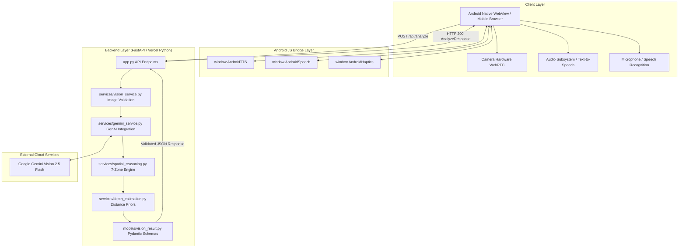

# 🏛️ Vision Lens — Architecture Specification

## 1. System Overview

Vision Lens is an AI-powered visual assistance system designed for visually impaired users. It combines a mobile-first HTML5/JavaScript camera interface, a Python FastAPI backend deployed via Vercel Serverless Functions, the Google GenAI SDK (Gemini Vision), and a native Android WebView wrapper with bidirectional JavaScript bridges.

---

## 2. Component Breakdown

### A. Frontend Web Application (`templates/`, `static/`)
- **`templates/index.html`**: Semantic, accessible HTML5 layout featuring camera viewfinder, directional HUD, status badges, action controls, and structured scene descriptions.
- **`templates/download.html`**: Installation portal providing direct APK downloads (`/vision-lens.apk`) and a live QR code.
- **`static/camera.js`**: Core client orchestrator. Manages `MediaDevices.getUserMedia()`, non-blocking speech state machines, Web Audio beacons, and fallback cascades between Android Native bridges and browser Web APIs.
- **`static/style.css`**: Accessible dark theme (`#0a0c10`), high-contrast accents (amber `#ffb703`, cyan `#00f0ff`, green `#06d6a0`), responsive grid layout, and touch targets (min 48px to 64px).

### B. Python FastAPI Backend (`app.py`, `api/index.py`)
- **`api/index.py`**: Vercel Serverless Function entry point exporting the ASGI application.
- **`app.py`**: FastAPI application handling CORS, defensive HTTP headers (`nosniff`, `SAMEORIGIN`, `strict-origin-when-cross-origin`), static file delivery, health checks, and analysis pipelines.
- **`models/vision_result.py`**: Strongly typed Pydantic models (`DetectedObject`, `VisionResult`, `BoundingBox`, `AnalyzeRequest`, `AnalyzeResponse`).

### C. Computer Vision & Spatial Intelligence Engine (`services/`)
- **`services/vision_service.py`**: Base64 image decoding, format validation, quality metric estimation (brightness, blur), and dynamic downsizing (max 800px) to minimize latency.
- **`services/gemini_service.py`**: Communicates with Google's multimodal models using `google-genai` SDK. Supports `gemini-2.5-flash` with graceful fallbacks.
- **`services/spatial_reasoning.py`**: Computes 7-zone horizontal alignment (`far_left`, `left`, `slightly_left`, `center`, `slightly_right`, `right`, `far_right`), 12-hour clock directions, path obstacle determination, and anti-hallucination guardrails.
- **`services/depth_estimation.py`**: Combines physical object priors with bounding box vertical and area scales to approximate metric distance tiers.
- **`services/speech_service.py`**: Lazily initialized server-side pyttsx3 fallback audio synthesizer.

### D. Android Native Application (`VisionLens-Hackathon-Android/`)
- **`MainActivity.kt`**: Hardware-accelerated WebView container loading the verified production domain (`https://vision-lens-ivory.vercel.app`).
- **Hardware Bridges**:
  - `AndroidTTSInterface`: Native Android `TextToSpeech` with `UtteranceProgressListener` completion callbacks.
  - `AndroidSpeechInterface`: Native Android `SpeechRecognizer` for offline and device-level voice command capture.
  - `AndroidHapticsInterface`: Hardware vibration patterns for target acquisition and hazard alerts.
- **Permission Pipeline**: Runtime management for `android.permission.CAMERA` and `android.permission.RECORD_AUDIO`.

---

## 3. Data Flow

1. **User Input / Capture**: The user triggers an interaction via voice command, quick chip, or the manual Capture button.
2. **Frame Extraction**: The browser canvas extracts a downscaled JPEG snapshot from the WebRTC video stream.
3. **API Request**: The client sends a `POST /api/analyze` request with the base64 image and optional query/mode.
4. **Validation & Optimization**: `VisionService` decodes the base64 string, validates dimensions, and verifies clarity.
5. **Multimodal Inference**: `GeminiService` invokes Gemini Vision with structured JSON schemas and spatial guidance prompts.
6. **Spatial Post-Processing**: `SpatialReasoningEngine` maps bounding boxes to 7 horizontal zones, clock-face bearings, and path obstacle flags.
7. **Client Presentation**: The frontend updates the Scene Summary, populates detected object cards, updates the HUD reticle, and speaks the response using the non-blocking TTS engine.

