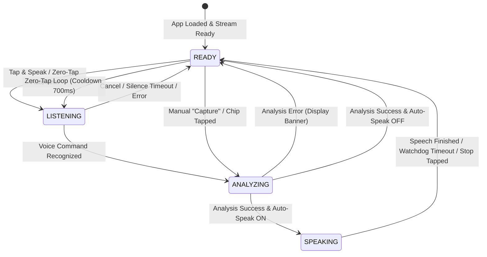

# 🔄 Vision Lens — System Workflow & State Machines

## 1. Application Lifecycle & Speech State Machine

Vision Lens maintains state separation between speech synthesis (TTS) and voice recognition (STT) to avoid self-transcription and prevent UI lockups.

---

## 2. Interaction Modes

### Mode 1: Manual Capture
1. User taps **Capture** (`#captureBtn`).
2. UI enters `ANALYZING` state; button displays `Analyzing Scene...` and scan animation starts.
3. Frame is posted to `/api/analyze`.
4. Response updates Scene Summary and Detected Objects.
5. If Auto-Speak is enabled, the AI description is read aloud; UI transitions to `SPEAKING` state.
6. When speech concludes, UI returns to `READY` (`Tap & Speak`).

### Mode 2: Voice Command Query
1. User taps **Tap & Speak** or speaks in hands-free mode.
2. System listens for keywords:
   - *"What do you see?"* / *"Describe"* -> General scene analysis.
   - *"Find my keys"* / *"Find my bottle"* -> Target localization mode.
   - *"Read this"* / *"What's written?"* -> Text reading mode.
   - *"Start guidance"* -> Continuous guidance loop.
3. UI transitions directly to `ANALYZING`, processes the frame, and delivers targeted voice feedback.

### Mode 3: Continuous Spatial Guidance
1. User taps **Start Guidance** (`#continuousGuidanceBtn`) or speaks *"Start guidance"*.
2. Viewfinder activates continuous scan badge.
3. Periodic frames are evaluated with an anti-repetition cooldown (minimum 3.5s between non-urgent speech updates).
4. Immediate hazard alerts bypass the cooldown and trigger urgent haptic pulses.
5. User can stop guidance by tapping **Stop Guidance** or speaking *"Stop guidance"*.

---

## 3. Speech Synthesis & Watchdog Fallback Workflow

To prevent the "Speaking Response..." stuck state:
1. `stopSpeech()` cancels any pending browser utterances or Android TTS queues.
2. An expected duration is calculated based on word count: `Math.min(15000, Math.max(3000, wordCount * 380 + 2000))`.
3. A safety watchdog timer is armed.
4. Speech is dispatched via `AndroidTTS` (native APK) or `window.speechSynthesis` (browser).
5. When `onDone` / `onend` fires, the watchdog timer is cleared and `onSpeechFinished()` executes.
6. If the browser or operating system drops the completion event, the watchdog forces `onSpeechFinished()`, ensuring the UI always returns to `READY`.

